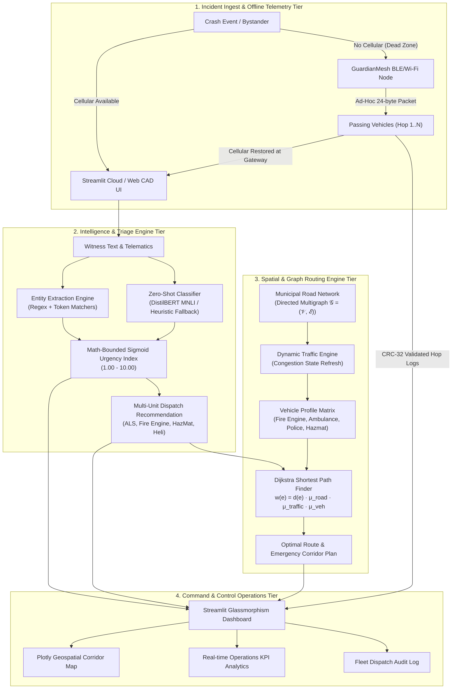
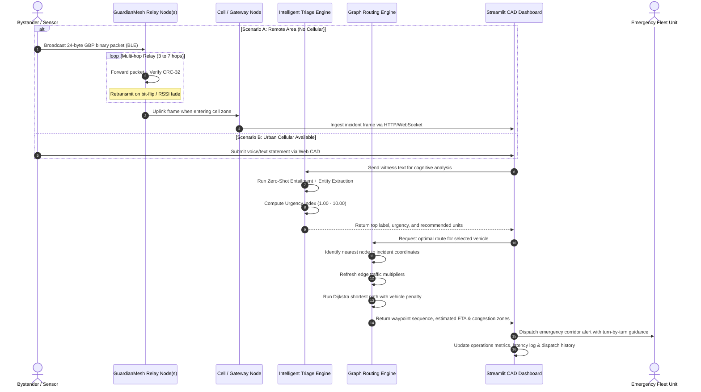
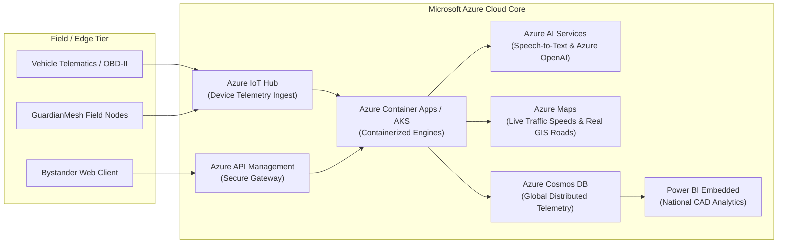

# GuardianNodes RoadSoS — System Architecture & Workflow Specification
**Microsoft Imagine Cup 2026 Competition Technical Blueprint**
*Team Coders | Project: GuardianNodes RoadSoS*

---

## 1. Executive Summary & Value Proposition

### 1.1 Problem Statement
Globally, **1.19 million lives are lost annually in road traffic accidents** (WHO Global Status Report on Road Safety). In severe trauma cases, the **"Golden Hour"** dictates that receiving surgical intervention within the first 60 minutes dramatically increases survival probability. Current municipal emergency dispatch systems suffer from three critical systemic bottlenecks:
1. **Connectivity Blackouts**: Accidents in remote highways, tunnels, or disaster zones encounter complete cellular dead zones, rendering traditional emergency apps and 911 dispatch lines non-functional.
2. **Unstructured Bystander Panic Reports**: Call takers receive fragmented, emotional bystander descriptions without standardized triage scoring, leading to inaccurate unit dispatch and wasted critical minutes.
3. **Rigid / Static Navigation**: Standard GPS navigators route all vehicles identically without accounting for vehicle physical profiles (e.g., a heavy ladder fire engine cannot maneuver narrow service lanes, while a motorbike medic can weave through gridlock).

### 1.2 Our Solution: GuardianNodes RoadSoS
**GuardianNodes RoadSoS** is an edge-to-cloud emergency intelligence infrastructure that integrates:
- **Offline Mesh Protocol Telemetry (GuardianMesh)**: Relay critical SOS frames over ad-hoc BLE/Wi-Fi Direct hops across passing vehicles to bridge cellular gaps.
- **On-Device Zero-Shot AI Triage Engine**: DistilBERT Natural Language Inference (NLI) model parsing witness statements into standardized urgency metrics (1.00–10.00) and actionable entity clusters.
- **Dynamic Traffic-Aware Dijkstra Graph Routing**: NetworkX multi-vehicle routing optimizing travel time based on road classification, congestion penalties, and vehicle dimension profiles.
- **Real-Time Command & Control Dashboard**: Live operations telemetry, hex payload verification, and performance KPIs.

### 1.3 UN Sustainable Development Goals (SDGs) & Microsoft Imagine Cup Alignment
- **UN SDG 3.6**: Halve the number of global deaths and injuries from road traffic accidents.
- **UN SDG 11.2**: Provide access to safe, affordable, accessible, and sustainable transport systems for all.
- **Microsoft Imagine Cup Focus Area**: Health & Lifestyle / Smart Infrastructure / AI Innovation.

---

## 2. High-Level System Architecture

---

## 3. Detailed Component Architecture

### Tier 1: Incident Ingest & Offline Mesh Telemetry (GuardianMesh)
When an accident occurs in remote corridors (mountain passes, tunnels, rural highways) with zero cellular coverage:
- The incident beacon or bystander smartphone generates a compact binary packet formatted according to the **GuardianNodes Binary Protocol (GBP)**.
- Packet serialization uses Python `struct` packing with network byte order (`!fffIHBB`), producing exactly **20 bytes of payload + 4 bytes CRC-32 checksum = 24 bytes total**.
- **Frame Layout**:
  - `latitude` (float32, 4 bytes)
  - `longitude` (float32, 4 bytes)
  - `urgency_index` (float32, 4 bytes)
  - `timestamp` (uint32, 4 bytes)
  - `sequence_number` (uint16, 2 bytes)
  - `flags` (uint8, 1 byte — Bit 0: Emergency SOS, Bit 1: Hazmat Warning)
  - `reserved` (uint8, 1 byte)
  - `crc32_checksum` (uint32, 4 bytes)
- **Transmission Mechanics**:
  - Transmitted over BLE Advertisement / Wi-Fi Direct peer-to-peer radio.
  - Multi-hop relay across passing vehicles with up to 3 automatic retransmissions upon bit-flip corruption or packet loss.
  - Upon reaching any node with cellular or Wi-Fi uplink, the packet is submitted to the central API gateway.

### Tier 2: Intelligent Triage Engine (Cognitive Core)
The natural language engine evaluates unstructured bystander reports without requiring rigid forms:
1. **Zero-Shot Natural Language Inference (ZSC)**:
   - Uses `DistilBERT-base-uncased-mnli` (with graceful fallback to keyword prior heuristics if offline).
   - Classifies statements against candidate emergency hypotheses:
     - `Fire/Explosion`
     - `Critical Medical Trauma`
     - `Vehicle Entrapment`
     - `Hazardous Material Leak`
     - `Minor Collision`
2. **Entity Extraction Pipeline**:
   - Discovers casualty counts (`"3 casualties"`, `"two injured"`).
   - Discovers vehicle counts (`"4 cars"`, `"one truck"`).
   - Detects fire keywords (`explosion`, `flames`, `smoke`).
   - Detects hazmat keywords (`gas leak`, `chemical`, `fuel spill`).
   - Detects speed indicators (`120 km/h`, `80 mph`).
3. **Urgency Formulation**:
   The urgency index $\mathcal{U} \in [1.00, 10.00]$ is mathematically bounded:
   $$\text{base} = \sum_{i} \left( \text{score}_i \times \text{weight}_i \right)$$
   $$\text{raw} = \frac{9}{1 + e^{-(6 \cdot \text{base} - 3)}} + 1$$
   $$\mathcal{U} = \text{clamp}\left(\text{raw} + \sum \text{bonuses}, 1.0, 10.0\right)$$
4. **Unit Allocation**:
   - Matches urgency and classification to resource matrices: Advanced Life Support (ALS) ambulances, heavy rescue entrapment units, HazMat decontamination teams, and trauma helicopter dispatch when $\mathcal{U} \ge 8.5$.

### Tier 3: Graph Routing Engine (Spatial Core)
A synthetic municipal grid network represented as a directed graph $\mathcal{G} = (\mathcal{V}, \mathcal{E})$ with 100 intersection nodes and 360 directed road edges.
1. **Dynamic Road Weighting**:
   Every edge $e = (u, v)$ carries:
   - Base physical great-circle distance $d(u, v)$ (Haversine formula).
   - Road type classification: `highway` ($\times 0.6$), `arterial` ($\times 1.0$), `local` ($\times 1.4$), `service_lane` ($\times 2.2$).
   - Dynamic real-time traffic condition: `clear` ($\times 1.0$), `moderate` ($\times 1.5$), `heavy` ($\times 2.5$), `gridlock` ($\times 4.0$).
   - Vehicle profile penalty $\mu_{\text{veh}}$ (e.g. Fire Engine carries $\times 3.5$ penalty on narrow service lanes; Motorbike medic carries $\times 1.0$ penalty across all).
2. **Cost Function**:
   $$w(e) = d(e) \cdot \mu_{\text{road}} \cdot \mu_{\text{traffic}} \cdot \mu_{\text{vehicle}}$$
3. **Pathfinding**:
   - Evaluates Dijkstra shortest path: $\min \sum_{e \in \mathcal{P}} w(e)$.
   - Automatically detects congested bottlenecks and designates emergency bypass corridors.

### Tier 4: Command & Control Dashboard (Operations Core)
Built on Streamlit with a glassmorphism dark-mode UI:
- **Real-Time Triage Card**: Dynamic circular Urgency Gauge, Plotly polar radar breakdown of confidence probabilities, and entity tags.
- **Interactive Geospatial Corridor**: Plotly scatter geo overlay illustrating the entire city road network, start depot, incident target, and optimal route path.
- **Binary Frame Inspector**: Live hex dump with color-coded CRC-32 validation.
- **Executive Operations Dashboard**: Response time trends, mesh packet delivery success rates, and fleet dispatch audit tables.

---

## 4. End-to-End Operational Workflow

---

## 5. Microsoft Cloud Scaling Roadmap (Azure Integration)

For national scaling and Microsoft Imagine Cup enterprise deployment, GuardianNodes RoadSoS natively maps to Microsoft Azure services:

### Azure Services Mapping:
1. **Azure IoT Hub & Event Grid**: Ingests high-frequency telematic collision pulses from on-vehicle sensors and mesh gateway nodes with end-to-end device identity security.
2. **Azure AI Speech & Azure OpenAI (GPT-4o)**: Translates multi-lingual bystander 911 audio calls in real time into structured text for instant DistilBERT triage processing.
3. **Azure Maps**: Upgrades the synthetic 100-node graph to live municipal road networks with live TomTom/Azure traffic speed vectors.
4. **Azure Container Apps**: Runs the containerized `roadsafety:latest` Streamlit dashboard and routing workers with automatic micro-scaling from zero.
5. **Azure Cosmos DB**: Stores multi-region immutable incident logs, ensuring sub-10ms response times for national control rooms.

---

## 6. Competitive Advantage Matrix

| Capability | Standard GPS (Google/Apple) | Legacy CAD (911/112 Systems) | **GuardianNodes RoadSoS** |
| :--- | :---: | :---: | :---: |
| **Offline Zero-Connectivity Mesh Relay** | ❌ None | ❌ None (Requires Tower) | ✅ **Built-in BLE/Wi-Fi GBP Protocol** |
| **Bystander Free-Text AI Triage** | ❌ None | ⚠️ Manual Operator Checklist | ✅ **Zero-Shot DistilBERT + Heuristic Fallback** |
| **Vehicle-Specific Physical Road Penalties** | ⚠️ Limited to Truck Speeds | ❌ Static Average Speeds | ✅ **Custom Road Class Penalties per Profile** |
| **Mathematical Urgency Indexing** | ❌ None | ⚠️ Coarse Categories (Code 1-3) | ✅ **Continuous Sigmoid Scale (1.00 - 10.00)** |
| **Integrated Packet Checksum Verification** | ❌ N/A | ❌ N/A | ✅ **CRC-32 Hardware Level Validation** |
| **Rapid Dockerized Deployment** | ❌ Proprietary | ❌ On-Premise Monolithic | ✅ **Zero-Config Docker & Compose Containers** |
